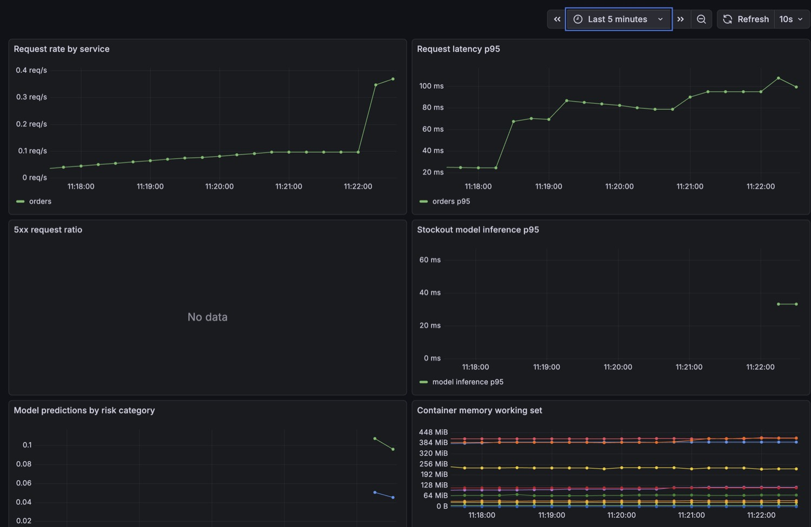
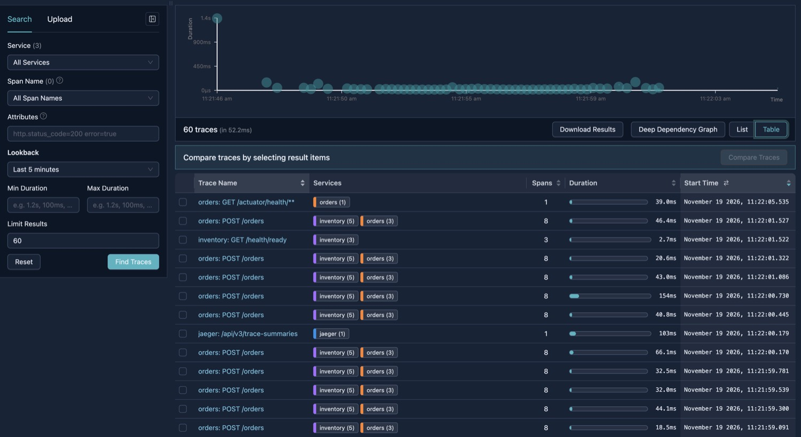
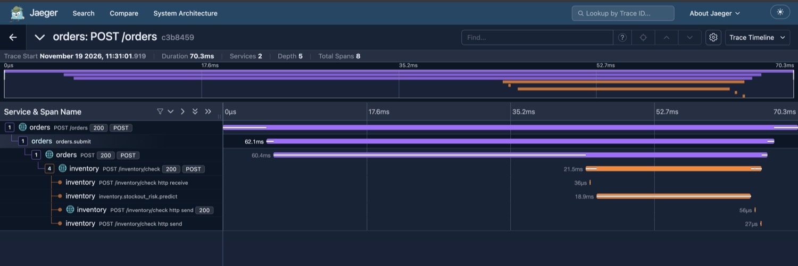
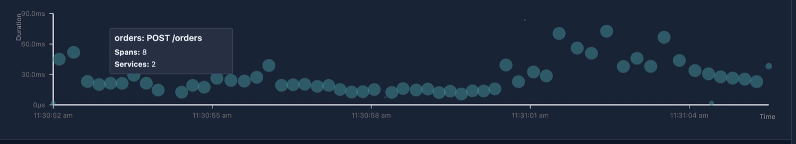
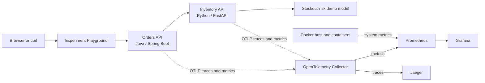

# Observable Order Platform

**A hands-on observability lab for following an order from a Java service into a Python service, then using metrics and traces to understand what happened.**

This project is a small e-commerce style system built to make observability practical and explorable. The Orders API is written in Java with Spring Boot. It calls an Inventory API written in Python with FastAPI. Inventory checks stock and runs a small stockout-risk model. OpenTelemetry sends telemetry to a Collector, Prometheus stores metrics, Grafana visualizes them, and Jaeger lets you follow each request across both services.

The project runs locally with Docker Compose. It does not need a cloud account or Kubernetes.

## What you can learn

- How a request travels through two microservices written in different languages.
- How automatic instrumentation captures HTTP server and client activity.
- Where application code adds meaning with custom metrics and spans.
- How OpenTelemetry sends signals through a Collector to Prometheus and Jaeger.
- How to use Grafana metrics and Jaeger traces together during an investigation.
- How to create repeatable slow and failing dependency scenarios.
- How to distinguish missing telemetry from a true zero value.

## Screenshots

### Grafana: service, latency, model, and container signals



The dashboard brings application and system signals into one view. In this capture the 5xx panel says **“No data.”** That does not prove the error rate is zero: it can mean that no matching samples were available for the selected time range or query. Check the raw series and query before drawing a conclusion.

### Jaeger: finding requests across services



The search view shows Orders requests involving both services, with trace duration and span count for each request.

### Jaeger: following one order end to end



This trace has **2 services and 8 spans**. The `orders.submit` span contains the order operation; the request then crosses into Inventory, where `inventory.stockout_risk.predict` marks the model inference work. The nested bars show where time was spent along the request path.

### Jaeger: comparing request durations



Each point represents a trace. The view makes it easier to spot slower requests and open one for a detailed timeline.

## Architecture



### Services and tools

| Part | Purpose |
|---|---|
| Experiment Playground | Browser page to create orders and trigger guided scenarios. |
| Orders | Spring Boot service that accepts an order and calls Inventory. |
| Inventory | FastAPI service that checks availability and runs the demo risk model. |
| OpenTelemetry instrumentation | Captures HTTP activity and records application-specific metrics and spans. |
| OpenTelemetry Collector | Receives OTLP telemetry and routes traces to Jaeger and metrics to Prometheus. |
| Prometheus | Scrapes and stores application and system metrics. |
| Grafana | Displays the provisioned service overview dashboard. |
| Jaeger | Searches and displays distributed traces. |
| node-exporter and cAdvisor | Provide host-VM and container resource metrics in Docker Desktop's Linux VM. |

## Telemetry in this project

Instrumentation is split between what the frameworks can observe automatically and what the application must explain.

- **Java Orders:** the OpenTelemetry Java agent captures supported HTTP server/client activity. The application also creates the `orders.submit` span and an `orders.accepted` business counter.
- **Python Inventory:** `FastAPIInstrumentor.instrument_app(...)` captures FastAPI request activity. Application code creates the `inventory.stockout_risk.predict` span, prediction and error counters, and the `inventory.stockout_risk.inference.duration` histogram.
- **The custom model span:** records attributes such as model name/version and risk category. These details help explain the model operation inside the larger order trace.
- **The Collector:** receives, processes, and exports telemetry. It does not add instrumentation to application code by itself.

Business metrics use bounded values such as risk category. Avoid using unique order IDs, customer IDs, or arbitrary user input as Prometheus labels; that can create too many time series.

## Run it locally

### Requirements

- Docker Desktop with Docker Compose
- A few GB of free memory for the services and observability tools

### Start

Clone the repository and start from its root directory:

```bash
git clone <your-github-repository-url>
cd observability-project
docker compose up --build
```

Open the Experiment Playground at **http://localhost:8088**.

| Tool | Address | Local demo login |
|---|---|---|
| Experiment Playground | [localhost:8088](http://localhost:8088) | None |
| Grafana | [localhost:3000](http://localhost:3000) | `admin` / `admin` |
| Prometheus | [localhost:9090](http://localhost:9090) | None |
| Jaeger | [localhost:16686](http://localhost:16686) | None |
| Orders readiness | [localhost:8080/actuator/health/readiness](http://localhost:8080/actuator/health/readiness) | None |
| Inventory readiness | [localhost:8000/health/ready](http://localhost:8000/health/ready) | None |

The Grafana dashboard and Prometheus data source are provisioned by the project. Docker Compose health checks wait for the Orders and Inventory readiness endpoints.

Stop the services with:

```bash
docker compose down
```

To also remove the local Prometheus data created by this Compose project:

```bash
docker compose down -v
```

## Try an order

The easiest way is to choose a scenario in the Playground and click **Run experiment**. You can also send a request from a terminal:

```bash
curl -s http://localhost:8080/orders \
  -H 'Content-Type: application/json' \
  -d '{"sku":"SKU-42","quantity":2,"dailyDemand":8,"onHand":40,"leadDays":4,"demandVolatility":2}'
```

The response includes whether the requested quantity is available and the model's estimated stockout-risk probability and category. This is a synthetic learning model, not a production inventory forecast.

Generate a stream of requests to make charts easier to read:

```bash
bash scripts/generate-traffic.sh
```

Set `REQUESTS=200` before running the script if you want a larger sample:

```bash
REQUESTS=200 bash scripts/generate-traffic.sh
```

## Guided experiments

1. **Establish a baseline.** Run several normal orders. In Grafana, look at request rate, latency, prediction activity, and container memory. In Jaeger, open an `orders: POST /orders` trace and follow its child spans into Inventory.
2. **Change model inputs.** Adjust daily demand, on-hand stock, lead time, and demand volatility in the Playground. Compare risk categories and inspect the `inventory.stockout_risk.predict` span.
3. **Slow Inventory down.** Use the Playground's slow-inventory scenario. Compare end-to-end order latency with model inference latency, then open a slow trace to see where the extra time appears.
4. **Make Inventory fail.** Use the failure scenario, send an order, and inspect the HTTP status, error metrics, and trace status. Restore normal behavior through the Playground after the experiment.
5. **Inspect system pressure.** Compare host-VM and per-container CPU/memory metrics while generating traffic. Docker Desktop runs containers in a Linux VM, so node-exporter reports VM signals rather than native macOS hardware metrics.
6. **Investigate missing chart data.** If a panel says “No data,” inspect its Prometheus query, selected time range, scrape targets, and whether the application has emitted a matching series. A missing series and a measured zero are different things.

See [the step-by-step experiment guide](docs/OBSERVABILITY_EXPERIMENT_GUIDE.md) for commands and expected observations. For a code and architecture walkthrough, see the [interview guide](docs/INTERVIEW_GUIDE.md) and [plain-English guide](docs/PLAIN_ENGLISH_GUIDE.md).

## Configuration map

```text
compose.yaml                              Services and local port mappings
observability/otel-collector.yaml         OTLP receivers and telemetry pipelines
observability/prometheus.yml              Prometheus scrape targets
observability/grafana/                    Provisioned dashboard and data source
services/orders-java/                     Java Spring Boot Orders service
services/inventory-python/                Python FastAPI Inventory service and model
services/playground-web/                  Browser experiment interface
scripts/generate-traffic.sh               Request generator
```

## Project scope and safety

This is a local learning project. The classifier trains on generated sample data when the Inventory service starts; it demonstrates where model telemetry belongs, not production-grade prediction quality. The project has no production database, authentication, alerting policy, or deployment configuration. The demo credentials and behavior controls are intentionally simple and should not be exposed to the public internet.

cAdvisor receives access to Docker's socket and host paths so it can inspect container resource use. Run the Compose stack only on a machine where you are comfortable with those local permissions. On Docker Desktop for macOS, host metrics come from the Linux VM used by Docker.

## Resume summary

Built a local multi-language observability lab using Java Spring Boot, Python FastAPI, OpenTelemetry, Prometheus, Grafana, Jaeger, and Docker Compose. Added custom business metrics and spans for order processing and stockout-risk inference, then used cross-service traces and dashboards to investigate latency, errors, and resource use.

## Learning guides

- [Hands-on labs](docs/HANDS_ON_LABS.md)
- [Step-by-step observability experiments](docs/OBSERVABILITY_EXPERIMENT_GUIDE.md)
- [Architecture and interview guide](docs/INTERVIEW_GUIDE.md)
- [Plain-English guide](docs/PLAIN_ENGLISH_GUIDE.md)
- [Medium article draft](docs/MEDIUM_ARTICLE_DRAFT.md)
